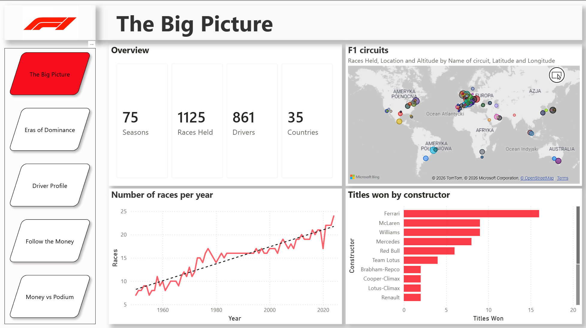
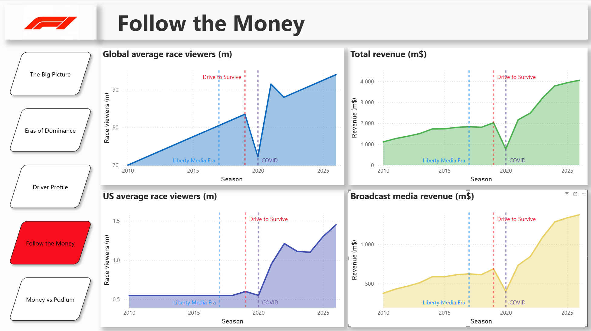
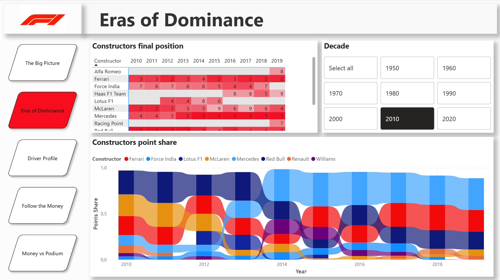
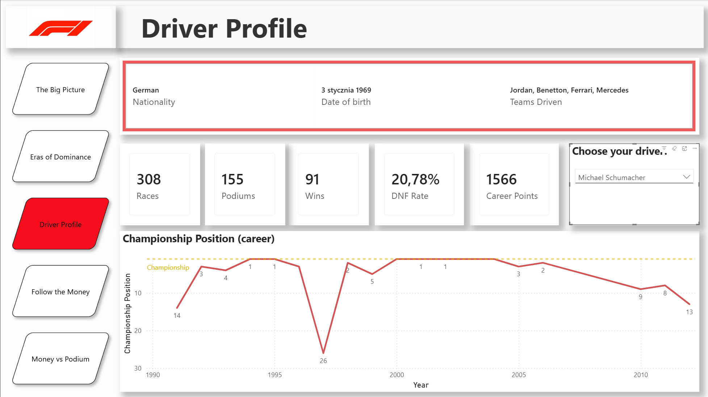
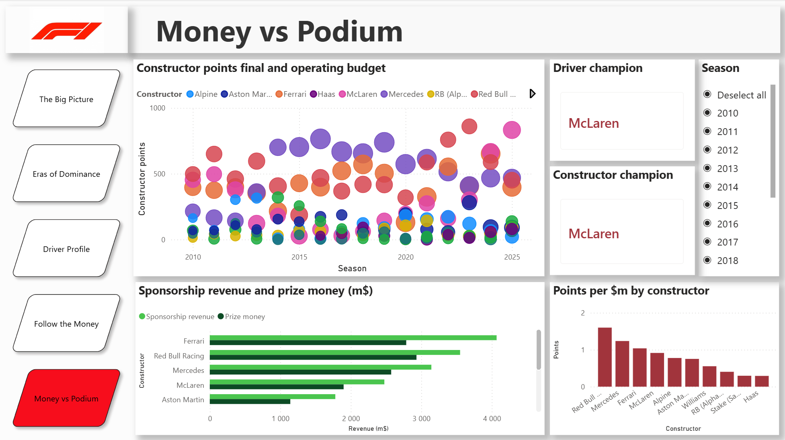

# Formula 1: From Sport to Business

---

## The questions this report answers

- Which teams actually dominated F1?
- What did Liberty Media and *Drive to Survive* really do to Formula 1's revenue, and to its audience?
- Does a bigger budget buy a championship?
- What does a full career look like season by season — the title years, the lean ones, and how often the car simply failed to finish?

---

## Pages

| Page | What it shows |
|---|---|
| **The Big Picture** | Four KPIs covering the whole history — 75 seasons, 1,125 races, 861 drivers, 35 countries — a world map sized by how often each circuit has hosted a Grand Prix, the growth of the calendar from 7 races in 1950 to 24 in 2024 with a trend line, and all-time constructors' titles |
| **Eras of Dominance** | A heatmap of every constructor's final championship position, season by season, filtered by decade; below it a ribbon chart of points share, which keeps eras comparable even though the points system kept changing |
| **Driver Profile** | Pick any driver from 75 years of the sport: nationality, date of birth, teams driven for, career totals (races, wins, podiums, points, DNF rate) and championship position for every season raced |
| **Follow the Money** | Four parallel series from 2010 to 2026 — global audience, US audience, total revenue and broadcast revenue — each marked with the Liberty Media takeover (2017), *Drive to Survive* (2019) and COVID (2020), so the same three events can be read against very different curves |
| **Money vs Podium** | Operating budget against points scored, season by season and team by team; sponsorship revenue versus prize money; and a points-per-$m ranking that shows who converts spending into results. Season slicer, with cards calling out that season's drivers' and constructors' champions |

| | |
|---|---|
|  |  |
|  |  |

---

## Data

| Source | Contents | Link |
|---|---|---|
| Formula 1 World Championship (1950–2024) | races, results, qualifying, lap times, pit stops, standings, drivers, constructors, circuits | [KAGGLE F1 1950-2020](https://www.kaggle.com/datasets/rohanrao/formula-1-world-championship-1950-2020) |
| F1 business & constructor finances (2010–2026) | revenue structure, team budgets, sponsorship, prize money, cost-cap limits, audience figures | [KAGGLE F1 INDUSTRY 2010-2026](https://www.kaggle.com/datasets/sergionefedov/formula-1-racing-industry-2010-2026) |

The raw CSV files are **not** committed to this repository — download them from the links above and point the Power Query sources at your local folder.
